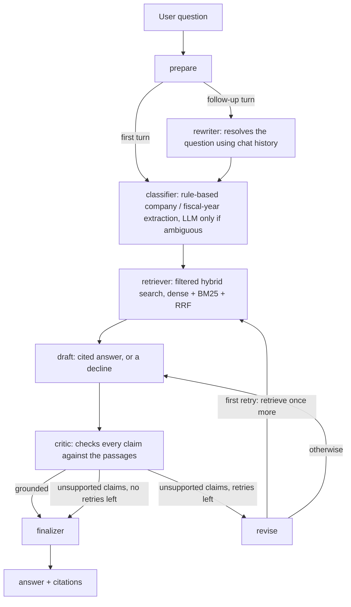

# Verity: a self-critiquing RAG agent over SEC 10-K filings

[](https://github.com/agananya03/Verity/actions/workflows/ci.yml)

Verity answers questions about the annual reports (Form 10-K) of Apple, Microsoft, Amazon, NVIDIA and Alphabet. It is a LangGraph agent: it extracts the company and fiscal year from the question, retrieves passages with a hybrid dense + keyword search, drafts a cited answer, has a second model check the draft against the passages, and declines when the filings do not contain the answer. The backend is FastAPI (streaming over SSE) and the frontend is Next.js. It is built to run on free tiers.

This README reports what was measured, including the parts that did not work. All numbers below come from files in `backend/eval/results/`, and every claim says how many questions it rests on.

> Not investment advice. Answers are generated by language models and can be wrong. Check the cited passages.

---

## What it is

| | |
|---|---|
| Corpus | 5 companies, three fiscal years each, Items 1, 1A, 7 and 8 of each 10-K. 2,921 chunks. |
| Retrieval | Qdrant dense search (`BAAI/bge-small-en-v1.5` via fastembed) + BM25, fused with Reciprocal Rank Fusion (k=10), filtered by company and fiscal year |
| Generator / critic | `gemini-3.5-flash-lite` / `gemini-3.1-flash-lite` (Google Gemini API, free tier) |
| Orchestration | LangGraph, up to 2 revision rounds |
| API | FastAPI, `POST /chat` (SSE), rate limited to 10 requests per minute per client |
| Frontend | Next.js (App Router), Tailwind, shadcn/ui |
| Hosting | Render (backend), Vercel (frontend), Qdrant Cloud (vectors) |

## Architecture



- **Classifier.** A deterministic extractor finds the company and fiscal year. It calls the LLM only when the question is ambiguous. The extracted company and year become metadata filters on retrieval. Questions that name no company or year are searched unfiltered.
- **Retriever.** The question is cleaned of boilerplate such as "according to the fiscal year 2024 Form 10-K" (dates such as "June 30, 2024" are kept), then searched densely (top 50) and with BM25 (top 50), and fused with RRF (k=10). The default strategy is `RETRIEVAL_STRATEGY=clean_v3_rrf10`. `legacy` restores the earlier behaviour. Multi-year questions use a per-year retrieval path that has not been validated on enough data (see Limitations).
- **Critic and finalizer.** If the critic flags unsupported claims after the last retry, the finalizer deletes the sentences that contain them. If nothing is left, it returns a decline message.

## Results

### How the evaluation was built, and why there are three sets

1. **Dev set** (`golden_set.json`, 18 answerable questions, 14 of them single-year). I tuned retrieval on it, and production retrieval scored 14/14 on the single-year ones. That turned out to be overfitting.
2. **Round 1, held-out** (`golden_heldout.json`, 64 answerable questions, 62 of them single-year). Written afterwards from different chunks. The earlier production retrieval scored 56.5% on the single-year ones. Round 1 was then used to diagnose problems, so it is no longer a clean test either.
3. **Round 2, fresh** (`golden_round2.json`, 82 questions: 62 single-year, 6 multi-year, 14 unanswerable). Generated from chunks disjoint from both earlier sets (neighbouring chunks also excluded), with the configs and metrics written down before scoring in `backend/eval/round2_preregistration.md`. It was scored once.

Questions in rounds 1 and 2 were generated by an LLM from chunk text, with the gold chunk fixed by a verbatim quote, then reviewed by a different LLM (Claude), not by a human. The judged answers were not audited by a human at scale; a small sample is laid out in `results/e2e_spot_check*.md`. Round 2 questions name the company and fiscal year, so they measure retrieval when the user states those. Question wording and filtering are discussed in Limitations.

The round 2 pre-registration file was written before generation, but it was first committed on 2026-11-17, after the round 2 scoring run (2026-11-16). The git history therefore does not prove it was written first; you are taking my word for the order. The end-to-end pre-registration (`backend/eval/e2e_preregistration.md`) was committed before the end-to-end results.

### Retrieval on round 2 (fresh, single-year, n=62)

Hit@8 means a gold chunk is in the top 8.

| Config | Hit@8 | 95% CI (Wilson) | Hit@20 |
|---|---|---|---|
| A: earlier production retrieval (`legacy`) | 44/62 = 71.0% | 58.7 to 80.8% | 88.7% |
| **B: current default (`clean_v3_rrf10`)** | **46/62 = 74.2%** | 62.1 to 83.4% | 83.9% |
| C: BM25 only, same filters | 40/62 = 64.5% | 52.1 to 75.3% | 80.6% |

B vs A: +2 questions, exact McNemar p = 0.73. B vs C: p = 0.18. None of these differences is statistically significant. The honest reading is that B is at least as good as the previous retrieval, at the same latency (about 262 ms vs 270 ms end to end), and nominally ahead of BM25 alone, though not significantly. It is nominally lower than A at depth (hit@20: 83.9% vs 88.7%), also untested.

What happened before that:

| Set | Earlier production retrieval | Notes |
|---|---|---|
| Dev, single-year (n=14) | 100% | Tuned on these questions |
| Round 1 single-year (n=62) | 56.5% | Used for diagnosis, so not clean |
| Round 2 single-year (n=62) | 71.0% | Old retrieval looked much better on fresh data than on round 1 |

On round 1 the new default scored 71.0%, but round 1 had been used to pick it, and after multiple-comparison correction (Holm) the improvement over the old one in the pre-registered sweep was not significant (adjusted p = 0.29; this came from the sweep script's console output, and only the sweep's raw cache is committed, not a summary file). Round 2 shows the large round 1 gain mostly did not replicate. Please read the table above, not the round 1 number.

Multi-year questions (round 2, n=6, descriptive only): configs A and B reach recall@8 of 0.25, BM25-only reaches 0.58. Six questions is too few to conclude anything, but the multi-year path looks weak.

A cross-encoder reranker was tested and rejected: about 2.7 s per query and about 2.5 GB of memory in the measurement run, against a 512 MB free instance.

### End to end: baseline vs full agent (round 2 sample, n=30)

A stratified sample of 30 answerable single-year questions (fixed seed 42, `--filter-eligible --stratified-sample 30`).

- **Baseline:** raw question, dense-only retrieval, no filters, top 8, one generation call, no critic.
- **Verity:** the full agent described above.
- **Judge:** `gemma-4-31b-it` (a different model family from the generator and critic), run through RAGAS. Hit@8, MRR and numeric accuracy do not use an LLM.

Pre-registered analysis (all 30 items). Difference = Verity minus baseline, with a 95% bootstrap interval over questions:

| Metric | Baseline | Verity | Difference | 95% CI | Verity higher / equal / lower |
|---|---|---|---|---|---|
| Answer correctness (RAGAS) | 0.451 | 0.715 | +0.264 | +0.141 to +0.386 | 22 / 2 / 6 |
| Faithfulness (RAGAS) | 0.687 | 0.864 | +0.177 | -0.002 to +0.351 | 13 / 12 / 5 |
| Hit@8 | 0.267 | 0.800 | +0.533 | +0.367 to +0.700 | 16 / 14 / 0 |
| MRR@8 | 0.140 | 0.447 | +0.307 | +0.176 to +0.448 | 21 / 8 / 1 |
| Numeric accuracy (n=21) | 0.476 | 0.905 | +0.429 | +0.238 to +0.619 | 9 / 12 / 0 |
| Declined to answer | 14/30 | 4/30 | | | |

What this supports and what it does not:

- **Supported:** the full system answers more questions correctly than the naive baseline, mostly because it finds the right chunk far more often (hit@8 80% vs 27%). When it found the gold chunk (24 of 30 questions), it scored faithfulness 0.97 and correctness 0.80. When it did not (6 questions), 0.46 and 0.36.
- **Not supported:** that the faithfulness gain is real. The interval includes zero, and the judge scores refusals inconsistently: the baseline's 14 identical "I don't have enough information" answers were scored 0.0 seven times and 1.0 seven times. This is documented in `results/e2e_posthoc.md`.
- **Post-hoc, not pre-registered:** on the 15 questions where neither system declined, faithfulness was 0.840 vs 0.997 (difference +0.157, CI +0.067 to +0.253) and correctness 0.684 vs 0.822 (difference +0.138, CI -0.010 to +0.284).
- **The critic loop contributed almost nothing.** It requested a revision on 2 of 30 answers (6.7%), and both of those were answers that were already refusals, which the critic flagged as unsupported. Do not read these numbers as evidence that self-critique improves answers.
- **The baseline is deliberately naive** (unfiltered, dense-only). Most of the gain is from metadata filtering and hybrid retrieval, which the retrieval ablations isolate (`results/retrieval_ablation*.md`). The comparison shows what the whole system adds over plain RAG, not what each part adds.

## Limitations

- **Small, synthetic benchmarks.** 62 to 64 questions per retrieval set and 30 for end to end. Intervals are wide. Questions were written and reviewed by models, not people.
- **Filters need a named company and year.** On round 2 the extractor got both right on 68 of 68 questions, but only because the questions name them. The extractor reads calendar years as fiscal years, which is wrong for companies whose fiscal year differs. For example, "late August 2024" belongs to NVIDIA's fiscal 2025, so a question phrased that way is filtered to the wrong filing.
- **Multi-year questions** use a per-year retrieval path that has only 8 test questions across both rounds. Treat it as unvalidated.
- **NVIDIA and number-heavy tables retrieve worst.** NVIDIA scored 5/12 on round 2 under every config. Financial tables are flattened to text by the chunker, which loses row and column structure.
- **Judge limits.** An LLM judge from another family is still an LLM. Refusal scoring is unreliable (see above), and answer correctness is harsh on verbose but correct answers.
- **Free-tier operation.** Free hosting tiers sleep when idle, so the first request after a pause can take about a minute. Gemini free quotas limited how large the end-to-end evaluation could be.

## Reproducing the evaluation

All evaluation code is under `backend/eval/`. Retrieval and judged results are committed in `backend/eval/results/`.

```bash
# retrieval scoring on round 2 (no LLM calls; needs Qdrant credentials)
python -m backend.eval.score_round2        # refuses to overwrite existing results

# end to end (needs GOOGLE_API_KEY; the judge model is set with JUDGE_MODEL)
python -m backend.eval.run_ragas_eval --golden-path backend/eval/golden_round2.json \
  --filter-eligible --stratified-sample 30 --seed 42 --config baseline --stage generate
python -m backend.eval.run_ragas_eval --golden-path backend/eval/golden_round2.json \
  --filter-eligible --stratified-sample 30 --seed 42 --config improved --stage generate
JUDGE_MODEL=gemma-4-31b-it python -m backend.eval.run_ragas_eval --config baseline --stage judge \
  --metrics faithfulness,answer_correctness --judge-workers 2 --judge-retries 8
python -m backend.eval.analyze_e2e
```

The end-to-end generation and judging take a few hours on free quotas, because the judge model is slow and often returns 503. Runs resume from checkpoints.

## Running it locally

```bash
git clone https://github.com/agananya03/Verity && cd Verity
pip install -r backend/requirements.txt
cp .env.example backend/.env        # GOOGLE_API_KEY, QDRANT_URL, QDRANT_API_KEY
python -m uvicorn backend.api.main:app --reload

cd frontend && npm install && NEXT_PUBLIC_API_URL=http://localhost:8000 npm run dev
```

The indexed corpus lives in Qdrant, and the BM25 index is rebuilt at startup from `backend/artifacts/`. To rebuild the index from the filings see `backend/ingestion/`. Deployment steps for Render and Vercel are in [DEPLOYMENT.md](DEPLOYMENT.md). Tests: `python -m pytest backend/tests -q`.

## What I would do next

- A human-written benchmark of 100+ questions, so the confidence intervals stop being the main story.
- Table-aware chunking for the financial statements, and a structured (XBRL) numeric lookup for figures.
- A fix for calendar-vs-fiscal-year mapping in the extractor, and a real test set for multi-year questions.
- Make the critic stop flagging refusals as unsupported, then measure whether the critic loop helps at all.

## License

MIT, see [LICENSE](LICENSE).
