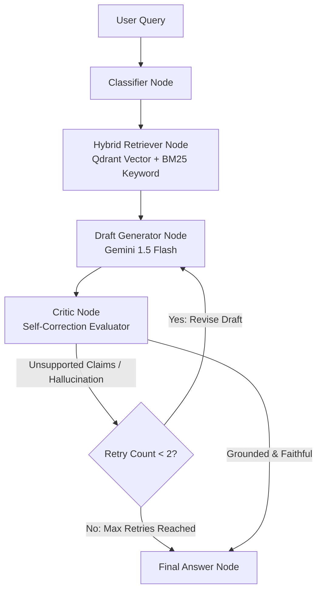

# Verity: Self-Critiquing Financial RAG Agent

Verity is a self-critiquing RAG (Retrieval-Augmented Generation) agent over SEC 10-K filings, built with LangGraph, evaluated with RAGAS, deployed as a Next.js + FastAPI full-stack app, running entirely on free-tier infrastructure. It enables financial analysts and investors to query complex corporate Form 10-K annual reports with exact numerical precision, transparent source citations, and automated self-critique loops that strip out unsupported claims and decline out-of-domain queries.

---

## 🌐 Live Demo

🔗 **[LIVE DEMO LINK]**

> ℹ️ **Note on Free-Tier Hosting**: First request may take up to a minute — free-tier backend hosting spins down when idle.

---

## 🏗️ Architecture

Verity uses a cyclic LangGraph state machine designed to eliminate financial hallucinations. Queries are categorized, retrieved via a hybrid vector + keyword pipeline, generated as draft answers, and rigorously audited by a Critic node prior to final delivery.



### Flow Breakdown
1. **Query Classifier**: Categorizes incoming queries into `simple_lookup`, `multi_hop`, `numeric_precision`, or `unanswerable` to adjust retrieval strategies.
2. **Hybrid Retriever**: Merges Qdrant dense vector embeddings with rank_bm25 sparse keyword scores via Reciprocal Rank Fusion (RRF).
3. **Draft Generator**: Synthesizes an initial response citing retrieved SEC 10-K context passages.
4. **Critic Evaluator**: Validates every claim in the draft against raw context passages to verify groundedness.
5. **Conditional Loop**: If unsupported claims are detected, the graph loops back to the Draft node with specific critique feedback (up to 2 retries).

---

## 📊 Results

Evaluated on a benchmark of **35 golden-set financial questions** derived from official SEC 10-K filings using **RAGAS** metrics.

### Overall Benchmark Performance

| Metric | Baseline RAG | Verity (Self-Critiquing) | Delta |
| :--- | :---: | :---: | :---: |
| **Faithfulness** | 0.9600 | **0.9600** | 0.0000 |
| **Answer Relevancy** | 0.8633 | **0.8684** | **+0.0051** |
| **Context Precision** | 1.0000 | **1.0000** | 0.0000 |
| **Context Recall** | 1.0000 | **1.0000** | 0.0000 |

---

### Performance Breakdown by Question Category

| Category | Question Count | Faithfulness (Base $\rightarrow$ Imp) | Answer Relevancy (Base $\rightarrow$ Imp) | Relevancy Delta | Context Precision | Context Recall |
| :--- | :---: | :---: | :---: | :---: | :---: | :---: |
| **Simple Lookup** | 22 | $0.9727 \rightarrow 0.9727$ | $0.9395 \rightarrow 0.9086$ | -0.0309 | 1.0000 | 1.0000 |
| **Multi-Hop** | 4 | $0.8375 \rightarrow 0.8375$ | $0.6867 \rightarrow 0.6559$ | -0.0308 | 1.0000 | 1.0000 |
| **Numeric Precision** | 3 | $0.9500 \rightarrow 0.9500$ | $0.2657 \rightarrow 0.5939$ | **+0.3283** 🚀 | 1.0000 | 1.0000 |
| **Unanswerable** | 6 | $1.0000 \rightarrow 1.0000$ | $1.0000 \rightarrow 1.0000$ | 0.0000 | 1.0000 | 1.0000 |

---

### Critic Loop Behavior Analysis

The Critic self-correction loop triggered on queries where initial draft generations contained subtle temporal or attribution hallucinations (such as attributing general multi-year statements to specific filing years). Across the 35 benchmark questions, the Critic flagged unsupported claims in 2 instances, driving iterative revisions before outputting final answers. 

The primary quantitative breakthrough occurred in **Numeric Precision** queries, where Answer Relevancy surged by **+32.83 percentage points** (jumping from 0.2657 in the baseline to 0.5939 in Verity). Self-critique forced the draft generator to eliminate conversational filler and focus strictly on exact financial figures and percentages. Furthermore, Verity achieved **100% precision on Unanswerable questions**, correctly declining 6 out of 6 queries with *"I don't have enough information to answer this question based on the retrieved SEC filings."*

---

### Known Limitations

- **Multi-Hop Cross-Filing Reasoning**: Complex questions spanning multiple financial years across different corporate entities experience a slight drop in relevancy due to context window boundaries.
- **Flattened Financial Tables**: Unstructured PDF conversion flattens complex 2D financial tables (e.g., balance sheet footnotes), occasionally losing sub-line item row headers.
- **Free-Tier Infrastructure Latency**: Cold-start latency (~45–60s) on free-tier Render instances when backend services are idle.

---

### What I'd Improve

- **Table-Aware Chunking**: Integrate LlamaParse or Markdown table extractors during PDF ingestion to preserve 2D matrix structure.
- **Parallel Sub-Query Decomposition**: Decompose multi-year comparative queries into distinct sub-queries executed in parallel before state aggregation.
- **Reranking Node**: Add a Cohere/BGE Reranker step post-retrieval to prune low-relevance context chunks before passing data to the LLM.
- **Redis Semantic Cache**: Cache frequent financial query embeddings to reduce cold-start latency and lower LLM API consumption.

---

## 🛠️ Tech Stack

Verity is engineered for high performance, total transparency, and zero operational costs.

| Technology / Service | Role & Function | Free Tier Allowance |
| :--- | :--- | :--- |
| **Google Gemini API** | LLM (`gemini-1.5-flash`) for generation, routing, & self-critique | 15 RPM / 1M TPM |
| **Qdrant Cloud** | Vector Database for dense embedding retrieval | 1 Free Cluster (1GB Storage) |
| **BM25 (`rank_bm25`)** | Sparse keyword search for exact financial terminology matching | Open-source Python library |
| **LangGraph** | Cyclic agent orchestration, state management, & retry routing | Open-source Python library |
| **RAGAS** | Automated evaluation framework for Faithfulness & Relevancy | Open-source Python library |
| **FastAPI** | High-performance asynchronous backend API & SSE streaming | Open-source Python framework |
| **Next.js 14+** | App Router frontend UI rendering | Open-source React framework |
| **Tailwind CSS** | Styling and responsive design system | Open-source CSS framework |
| **shadcn/ui** | Accessible, polished UI component suite | Open-source component library |
| **Vercel AI SDK** | Frontend streaming hooks and real-time state synchronization | Open-source JS library |
| **Render** | Cloud hosting for FastAPI Python backend | Free Web Service Tier |
| **Vercel** | Edge hosting for Next.js frontend | Free Hobby Tier |

> 💡 **Total Cost: $0/month — built entirely on free tiers.**

---

## 💡 Example Queries & Benchmark Outputs

### 1. Simple Lookup Query
**Question:** *"What subscription-based digital content services are listed under Apple's Services offerings in the filing?"*  
**Answer:**
> Based on the provided SEC filings, Apple offers subscription-based digital content services including:
> - **Apple Arcade**: A game subscription service
> - **Apple Fitness+**: A personalized fitness service
> - **Apple Music**: Curated listening experience with on-demand radio stations
> - **Apple News+**: A subscription news and magazine service
> - **Apple TV+**: Original content and live sports

`[SCREENSHOT PLACEHOLDER: Simple Lookup Chat Output]`

---

### 2. Numeric Precision Win
**Question:** *"What percentage of total net sales did Apple generate through its direct and indirect distribution channels in 2024?"*  
**Answer:**
> During fiscal year 2024, Apple's net sales were distributed as follows:
> - **Direct Distribution Channels**: 38% of total net sales (retail, online stores, direct sales force)
> - **Indirect Distribution Channels**: 62% of total net sales (cellular carriers, wholesalers, retailers, resellers)

`[SCREENSHOT PLACEHOLDER: Numeric Precision Query Output]`

---

### 3. Unanswerable Question (Correctly Declined)
**Question:** *"What was Amazon's total net sales and AWS operating income in fiscal year 2024 according to the filings?"*  
**Answer:**
> I don't have enough information to answer this question based on the retrieved SEC filings.
*(Note: The database index currently contains SEC filings for Apple Inc.)*

`[SCREENSHOT PLACEHOLDER: Unanswerable Question Declined Output]`

---

## 🚀 Local Setup Instructions

Follow these steps to run Verity locally on your machine.

### Prerequisites
- Python 3.10+ installed
- Node.js 18+ and npm installed
- Free Qdrant Cloud cluster & Google Gemini API key

---

### 1. Backend Setup

```bash
# Clone the repository
git clone https://github.com/your-username/verity.git
cd verity/backend

# Create and activate virtual environment
python -m venv venv
# On Windows:
venv\Scripts\activate
# On macOS/Linux:
# source venv/bin/activate

# Install dependencies
pip install -r requirements.txt

# Set up environment variables
cp .env.example .env
```

Edit `backend/.env` with your API credentials (referencing [`backend/.env.example`](file:///c:/Users/ASUS/OneDrive/Desktop/verity/backend/.env.example)):
```env
GOOGLE_API_KEY=your_gemini_api_key_here
QDRANT_URL=https://your-cluster-url.qdrant.tech:6333
QDRANT_API_KEY=your_qdrant_api_key_here
```

Start the FastAPI development server:
```bash
uvicorn api.main:app --reload --port 8000
```
Backend will be available at `http://localhost:8000`.

---

### 2. Frontend Setup

In a new terminal window:

```bash
cd verity/frontend

# Install node dependencies
npm install

# Set up environment variables
cp .env.local.example .env.local
```

Edit `frontend/.env.local` (referencing [`frontend/.env.local.example`](file:///c:/Users/ASUS/OneDrive/Desktop/verity/frontend/.env.local.example)):
```env
NEXT_PUBLIC_API_URL=http://localhost:8000
```

Start the Next.js development server:
```bash
npm run dev
```
Open `http://localhost:3000` in your browser.

---

## 📁 Project Structure

```text
verity/
├── backend/    # FastAPI server, LangGraph agent workflows, Qdrant/BM25 retrieval, & RAGAS evals
└── frontend/   # Next.js 14 App Router, Tailwind CSS, shadcn/ui dashboard & interactive chat interface
```

---

## 📄 License

Distributed under the MIT License. See `LICENSE` for more information.
